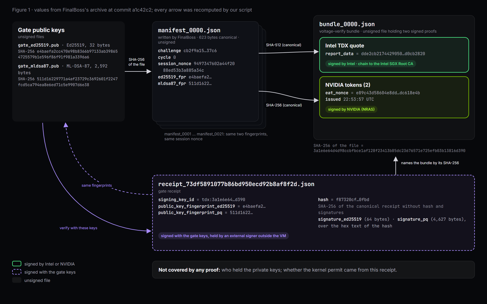
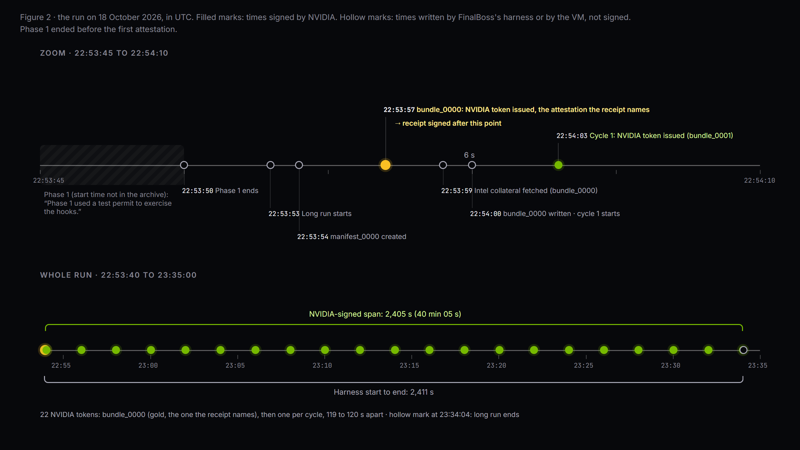

# Ring zero on an attested H100

VoltageGPU's copy of this article: https://voltagegpu.com/blog/ring-zero-attested-h100

By Final Boss Technology Inc. (Abraham Manzano) and VoltageGPU

This is a joint write-up. Final Boss Technology Inc. (FinalBoss) wrote sections 1, 2, 3 and 8: the run, the gate, its signed receipts and the enforcement in the kernel. VoltageGPU wrote sections 4 to 7 and the "Reproduce it" box: the Intel TDX and NVIDIA proofs, how the receipt is tied to them, and what our verifier printed. In those sections, "we" means VoltageGPU. Each side approved the other's sentences about its own system before publication.

The evidence is FinalBoss's public archive, GUEST_EVIDENCE_PHASE2.tar.gz at commit a1c42c2 (https://github.com/805-ai/finalboss-proof/tree/a1c42c2af9d14c0c44df215414a1efe5f13f286d/ring-zero-20261018). A path written proof/... is a file inside that archive.

## 1. What ran, and when

On 18 October 2026, FinalBoss loaded three eBPF cgroup hooks (connect4, sendmsg4 and sock_create) into the kernel of a VoltageGPU H100 confidential VM (Intel TDX) with one GPU, running kernel 6.8.0-110-generic. The run had two phases.

Phase 1 was a bounded test. Under the hooks, 3,000 of 3,000 unpermitted socket() calls were denied, and 3,000 of 3,000 permitted loopback TCP calls went through with zero failures. The median deny time was 10.94 µs. Phase 1 used a test permit to exercise the hooks. It ended at 22:53:50 UTC.

Phase 2 was the long run: 21 cycles, one every 120 seconds, from 22:53:53 to 23:34:04 UTC. Each cycle took a new hardware attestation, confirmed all three hooks attached, and ran a deny probe. All 21 cycles passed: 21 of 21 attestations succeeded, plus one attestation for the permit (cycle 0); 21 of 21 deny probes were denied; and 3 of 3 hooks were attached in every cycle. Phase 2 drew its permit from a signed gate receipt verified by permitctl. At the end, the hooks were detached. In round numbers, the long run lasted about 40 minutes.

Scope: this run covers network enforcement in the kernel. It does not cover BPF-LSM, and it makes no AMD SEV-SNP claim.

Sources: proof/OBSERVATIONS.json, proof/LATENCY.json, proof/LONG_RUN_SUMMARY.json, proof/CYCLES.jsonl, proof/MANIFEST.sha256 (77 files).

## 2. The gate and its signed receipts

The FinalBoss gate sits in front of an action. In phase 2, nothing ran without a signed receipt. Before the action is allowed, the gate records the intent and signs it.

The receipt published with this run names the action (connect4 127.0.0.1 worker pid 3071), an effect ID (73df5891077b86bd950ecd92b8af8f2d), an idempotency key, the phase (INTENT) and the status (INTENT_RECORDED). It also carries a signing key ID, the fingerprints of both public keys, and the signature mode, hybrid-ed25519-mldsa87.

The receipt hash is SHA-256 of the canonical JSON of the receipt (sorted keys, no whitespace) with the hash and both signatures removed. For this receipt, that is f87320cf1bcea80f29ccf6675dec83c73fa62179233aa990a18f2e882dae0fbd. Both signatures are computed over the hex text of that hash.

There are two signatures because one is not enough for the long term. Ed25519 is fast and widely trusted today. ML-DSA-87 is a post-quantum signature standardised by NIST. A forgery stays impossible as long as one of the two schemes holds, provided the verifier requires both signatures.

The signing_key_id points to a hardware attestation. It is tdx: followed by the SHA-256 of the attestation bundle for cycle 0 (3a1e6e64d4d98ccbfbce1af128f23413b85dc23676571e725efb03b13816d390). The receipt therefore names the exact attestation it was issued against.

Key custody: the gate used an external signer outside the VM. This run does not claim the keys were inside the VM.

Sources: proof/gate_keys/receipt_73df5891077b86bd950ecd92b8af8f2d.json, proof/gate_keys/gate_ed25519.pub, proof/gate_keys/gate_mldsa87.pub.

## 3. Enforcement in ring zero

The gate decides. The kernel enforces. FinalBoss attaches three cgroup hooks, each guarding one way out of the workload: sock_create blocks opening a socket, connect4 blocks opening a connection, and sendmsg4 blocks sending UDP datagrams over IPv4. The default is deny. A process can only get through if a permit for it exists in the kernel's permit map.

In phase 2, permitctl checked the signed gate receipt and only then wrote the permit. Revocation works the same way in reverse. In phase 1, after the test permit was revoked, all three hooks returned EPERM: connect4, sendmsg4 and sock_create.

Latency was measured with a worker in the cgroup, timing each call with perf_counter_ns: 3,000 TCP connect, send and close calls to a loopback listener for the allow path, and 3,000 socket() calls returning EPERM for the deny path.

The hooks were built ahead of time on the operator's machine. No compiler was present on the target. They were loaded with bpftool v7.8.0. The SHA-256 of each object is published:

```
finalboss_kts_connect4.bpf.o:
b373e9be7fb3fc5a6972760ba19645b30c8d47fbe5ef0b5bf02f2f3b3876b984
finalboss_kts_sendmsg4.bpf.o:
507b10398a390739f5df3599c9bc7d679b1dcbcfc86d8e6c4c66cd78313406b7
finalboss_kts_sock_create.bpf.o:
c879aefdb4337db15e739024fdecb1dbe4badc26bc5717b032c028a96ebfa417
source: 9ce4ad08df55aaed1b7055fe4708c14c62aaf6577b83efa0d200014d25a59143
```

The objects themselves are available to qualified reviewers under NDA. At the end of the run, all hooks were detached.

Sources: proof/BPF_LOAD.txt, proof/CGROUP_ATTACHMENTS.txt, proof/BPF_UNLOAD.txt, proof/LONG_BPF_LOAD.txt, proof/LONG_BPF_UNLOAD.txt, proof/OBSERVATIONS.json, proof/cycles/cycle_0001.json to cycle_0021.json.

## 4. Two hardware proofs: the Intel TDX quote and the NVIDIA GPU attestation

The run used a VoltageGPU H100 confidential VM (Intel TDX) with one GPU. The archive holds 22 attestation bundles: bundle_0000, taken for the gate permit before cycle 1, and bundle_0001 to bundle_0021, one per cycle. Each was made inside the VM with voltage-verify 0.2.1 and holds two proofs over one manifest.

**The manifest** holds a challenge, a creation time, a statement and workload fields, all written by FinalBoss. In the 22 manifests, the workload fields carry the company name, the cycle number, the session nonce 9497347602a44f2088ed53b3a885a34c and the SHA-256 fingerprints of the two gate public keys (e4baefa2… and 511d1622…).

**The Intel TDX quote** carries the SHA-512 of the canonical manifest (keys sorted, no whitespace, UTF-8) as its 64-byte report_data. Intel's Quoting Enclave signs it, the chain ends at the Intel SGX Root CA, and Intel's signed collateral rates the platform's patch level.

**The NVIDIA attestation** is a set of tokens signed by NVIDIA's attestation service (NRAS), whose eat_nonce is the SHA-256 of the same manifest. Change one byte of the manifest and neither proof matches it.

**What bundle_0000 shows** (the same values in all 22 bundles):

- Quote v4, 4,940 bytes. MRTD eea8b6a8…, the measurement of the VM's initial memory. RTMR3 is all zeros, so no runtime measurement was added. TD attributes 0000001000000000: debug off.
- Intel: platform TCB, Quoting Enclave and TDX module TDX_01 all UpToDate (TCB level of 13 August 2025); the PCK certificate and its CA are not revoked.
- NVIDIA: one GH100 GPU; measurements matched, secure boot on, debug disabled; driver 595.71.05, VBIOS 96.00.CF.00.01.

Inside the VM, `nvidia-smi conf-compute` reported CC State ON and Multi-GPU Mode None, the single-GPU confidential computing mode. The VM reported this itself; no signature covers it.

The MRTD equals the one in our public reference bundle of 12 September 2026 (examples/hello-workload/ in voltage-verify): the same virtual firmware image. RTMR0 to RTMR2 differ from that bundle's, and we publish no reference values for them.

**What this proves, and what it does not.** The 22 quotes come from one genuine Intel TDX platform that Intel rates UpToDate, NVIDIA issued the GPU claims, and each quote and its tokens commit to the same manifest. The proofs say nothing about software loaded after boot (RTMR3 is zero) or about what the GPU computed, and they commit to FinalBoss's statement and workload fields without checking them.

Sources: proof/cycles/ (manifests and bundles); section 6; docs/WHAT_IT_PROVES.md in voltage-verify; the public verification page of bundle_0000, https://voltagegpu.com/verified/Bf2xU9dGOQkHqrwrVQpyTw.

## 5. How the gate receipt is tied to the attestation

Section 2 describes the receipt. voltage-verify does not read it, so we checked the chain below with our own script, which recomputes each value from the published files (figure 1).

1. **Keys to manifest.** The SHA-256 of gate_ed25519.pub is e4baefa2… and the SHA-256 of gate_mldsa87.pub is 511d1622…: the two fingerprints in manifest_0000.json.
2. **Manifest to hardware.** The quote in bundle_0000.json carries the SHA-512 of that manifest as its report_data, and both NVIDIA tokens carry its SHA-256 as eat_nonce.
3. **Receipt to attestation.** The receipt's signing_key_id is tdx: followed by 3a1e6e64…, the SHA-256 of the file bundle_0000.json.
4. **Receipt to keys.** The receipt's two fingerprints equal the two key-file hashes. We recomputed the receipt hash as section 2 defines it and got f87320cf…, the value in the receipt, and both signatures verify over its hex text with the published public keys (Python cryptography 50.0.2). The hash covers signing_key_id and the fingerprints: when we changed one character of either, the hash changed and both signatures failed.
5. **Every cycle.** The 22 manifests carry the same two fingerprints and the same session nonce, so all 22 quotes and NVIDIA attestations commit to the same gate keys.
6. **Time.** The receipt contains the hash of bundle_0000.json, which holds an NVIDIA token issued at 22:53:57 UTC, so the receipt was signed after that time. The receipt has no time field of its own.



*Figure 1. From the gate keys to the hardware proofs and back to the receipt. Values from FinalBoss's archive at commit a1c42c2; every arrow was recomputed by our script.*

Legend: solid border, signed by Intel or NVIDIA; dashed border, signed with the gate keys; no border, unsigned file.

Figure 1 sources: proof/cycles/manifest_0000.json to manifest_0021.json, proof/cycles/bundle_0000.json and proof/gate_keys/ (commit a1c42c2).

**What this proves, and what it does not.** The receipt names the attestation in bundle_0000.json, and it is signed by the two keys whose fingerprints the attested VM put in its manifest. The keys were held by an external signer outside the VM, and this run makes no claim that they were inside it. The quote shows that software in the VM asked for a quote over a manifest holding those fingerprints, not who held the private keys. Nor does it show that the permit the kernel enforced came from this receipt: that rests on FinalBoss's logs.

Sources: proof/gate_keys/ (receipt and public keys); proof/cycles/ (manifests and bundle_0000.json); our check, in part 2 of the "Reproduce it" box.

## 6. What voltage-verify printed

We ran the "Reproduce it" box below on 22 October 2026, each time in a new directory with a new virtual environment: on Windows 11 with Git Bash (21:00:02 to 21:00:25 UTC) and on Ubuntu 24.04.1 (21:02:00 to 21:02:17 UTC). pip installed voltage-verify 0.2.3. Both runs printed the archive hash, 77 (every file in MANIFEST.sha256 matches) and RESULT: VERIFIED for all 22 bundles. voltage-verify 0.2.2 gives the same 22 results; on bundle_0000, its output differs from that of 0.2.3 only in the wording of the nvidia.signatures line.

The full output for bundle_0000 (offline, 0.2.3):

```
$ voltage-verify verify proof/cycles/bundle_0000.json --offline --challenge cb2f9a15fb882c3f1e9e3d5867b596d105f215d0bcad1bec2db437a3eebd37c6 --hwmodel GH100 --gpus 1
[PASS] manifest.format       manifest is well formed
[PASS] manifest.commitments  bundle commitments match the manifest
[PASS] manifest.challenge    challenge is the one this verifier issued
[PASS] tdx.structure         TDX quote v4, TEE 0x81, 4940 bytes
[PASS] tdx.debug             TD attributes 0000001000000000 (0x10000000), DEBUG (bit 0) off: not a debug TD
[PASS] tdx.report_data       quote report_data equals SHA-512 of the manifest
[PASS] tdx.signatures        attestation key, QE binding, QE report and PCK chain verify up to the pinned Intel SGX Root CA
[PASS] tdx.collateral        TCB info and QE identity signed by Intel (bundle (fetched 2026-10-18T22:53:59+00:00))
[PASS] tdx.tcb               platform TCB UpToDate, QE UpToDate, TDX_01 UpToDate
[PASS] tdx.revocation        PCK certificate not revoked (57 entries in CRL)
[PASS] tdx.revocation        PCK CA certificate not revoked (0 entries in CRL)
[PASS] nvidia.signatures     2 NVIDIA-signed tokens verify, keys from the bundle chained to a pinned NRAS intermediate (offline)
[PASS] nvidia.nonce          NRAS eat_nonce equals SHA-256 of the manifest
[PASS] nvidia.policy         overall result true, every GPU: measurements ok, secure boot on, debug off, nonce matched, report signature and chain validated
[PASS] nvidia.freshness      token issued 3s from bundle creation

TDX: MRTD eea8b6a814569a52bd1e12f6b869bb2d...  TCB UpToDate  QE UpToDate
GPU: GPU-0 GH100 driver 595.71.05 vbios 96.00.CF.00.01 measurements success

RESULT: VERIFIED
```

All 22 bundles, 18 October 2026:

| Bundle | NVIDIA token issued (UTC, signed by NVIDIA) | Intel collateral fetched (UTC, recorded in the bundle) | voltage-verify 0.2.3 |
|---|---|---|---|
| bundle_0000 | 22:53:57 | 22:53:59 | VERIFIED |
| bundle_0001 | 22:54:03 | 22:54:05 | VERIFIED |
| bundle_0002 | 22:56:03 | 22:56:05 | VERIFIED |
| bundle_0003 | 22:58:02 | 22:58:04 | VERIFIED |
| bundle_0004 | 23:00:02 | 23:00:04 | VERIFIED |
| bundle_0005 | 23:02:02 | 23:02:04 | VERIFIED |
| bundle_0006 | 23:04:02 | 23:04:04 | VERIFIED |
| bundle_0007 | 23:06:02 | 23:06:04 | VERIFIED |
| bundle_0008 | 23:08:02 | 23:08:04 | VERIFIED |
| bundle_0009 | 23:10:02 | 23:10:12 | VERIFIED |
| bundle_0010 | 23:12:02 | 23:12:04 | VERIFIED |
| bundle_0011 | 23:14:02 | 23:14:04 | VERIFIED |
| bundle_0012 | 23:16:02 | 23:16:04 | VERIFIED |
| bundle_0013 | 23:18:02 | 23:18:04 | VERIFIED |
| bundle_0014 | 23:20:02 | 23:20:04 | VERIFIED |
| bundle_0015 | 23:22:02 | 23:22:04 | VERIFIED |
| bundle_0016 | 23:24:02 | 23:24:04 | VERIFIED |
| bundle_0017 | 23:26:02 | 23:26:04 | VERIFIED |
| bundle_0018 | 23:28:02 | 23:28:04 | VERIFIED |
| bundle_0019 | 23:30:02 | 23:30:04 | VERIFIED |
| bundle_0020 | 23:32:02 | 23:32:04 | VERIFIED |
| bundle_0021 | 23:34:02 | 23:34:04 | VERIFIED |

The 22 quotes share one MRTD, one set of RTMR0 to RTMR3, one PCK certificate chain and one set of TCB values, and the 22 sets of NVIDIA tokens name one GPU (the same ueid). The 22 challenges are all different.

The selftest makes nine tampered copies of each bundle (manifest changes, a replayed challenge, an altered byte of the quote, an altered GPU claim, re-signed tokens, a duplicated signing key, stripped certificate chains) and checks that each one is rejected: 198 of 198 were.

Online, with Intel collateral fetched on 22 October 2026 at 21:04 UTC, bundle_0000 still verifies with the same ratings. We ran this for bundle_0000 only; the other 21 quotes come from the same platform with the same security version numbers.



*Figure 2. The run on 18 October 2026, in UTC. Filled marks: times signed by NVIDIA. Hollow marks: times written by FinalBoss's harness or by the VM, not signed. Phase 1 ended before the first attestation.*

Figure 2 sources: proof/OBSERVATIONS.json, proof/LONG_RUN_SUMMARY.json, proof/cycles/manifest_\*.json, bundle_\*.json and cycle_\*.json (commit a1c42c2).

**What this proves, and what it does not.** Each bundle answers the challenge in its own manifest, but FinalBoss set those challenges, not an outside verifier, so they do not show freshness to a reader. NVIDIA's signed timestamps do: from 22:53:57 to 23:34:02 UTC on 18 October 2026 (2,405 seconds), 6 seconds between bundle_0000 and bundle_0001, then 119 to 120 seconds between cycles (figure 2). Twenty-two quotes from one platform with one set of measurements fit one VM running for about 40 minutes, but they do not formally prove a single VM instance. Phase 1 (section 1) ended at 22:53:50 UTC, 7 seconds before the first attestation in the archive, so no hardware proof covers it.

Sources: our runs of 22 October 2026 (box below); voltage-verify 0.2.3 and 0.2.2 from PyPI; proof/OBSERVATIONS.json.

## 7. What the hardware side proves, and what it does not

This is the list from docs/WHAT_IT_PROVES.md in voltage-verify 0.2.3 (https://github.com/VoltageGPU/voltage-verify/blob/v0.2.3/docs/WHAT_IT_PROVES.md), for the checks printed in section 6.

| Check | Proves | Does not prove |
|---|---|---|
| `manifest.format` | the bundle is parseable | anything |
| `manifest.commitments` | bookkeeping is consistent | anything: an attacker can recompute them |
| `manifest.challenge` | the bundle was made for this session | anything without the TDX and NVIDIA checks below |
| `tdx.structure` | it is a TDX quote | anything about its origin |
| `tdx.debug` | the TD does not run in debug mode, in which the host can read and modify its memory and CPU state | anything on its own: the TD attributes are only Intel's word once `tdx.signatures` passes |
| `tdx.report_data` | the quote was requested with your manifest hash, so after your challenge | who requested it |
| `tdx.signatures` | the quote was produced by a genuine Intel TDX Quoting Enclave on Intel-provisioned hardware | that the platform's firmware is current |
| `tdx.collateral` | the collateral is Intel's | freshness (see `tdx.collateral_fresh`) |
| `tdx.tcb` | the platform is patched to a level Intel accepts | that no unknown vulnerability exists |
| `tdx.revocation` | Intel has not revoked this platform's provisioning identity | anything if CRLs are missing (then the line says NOT checked) |
| `nvidia.signatures` | NVIDIA issued these claims | when, until `nvidia.freshness` |
| `nvidia.nonce` | the claims were issued for your manifest hash, after your challenge | which VM: the TDX side does that |
| `nvidia.policy` | NVIDIA's service accepted the GPU's measurements and configuration | that the GPU executed your workload |
| `nvidia.freshness` | the token belongs to this attestation session | anything if the VM clock is wrong (the check then fails, which is the safe direction) |

The quote's `MRTD` and `RTMR0..3` are printed as facts. They measure the VM's initial state and boot chain. This tool does not compare them to a reference: whether a given `MRTD` is the image you expect is a policy decision that belongs to you.

**The gap this tool does not close.** Both proofs are bound to a description of the workload. Neither proof says that the described image or model was what the GPU computed on. Closing that gap requires a measured launch: a component inside the VM that measures the container image and the model before starting them and extends a TDX runtime measurement (`RTMR`) with the result, so that the quote itself carries the measurement. The Confidential Containers project (Kata + Trustee) and similar stacks do this. `voltage-verify` stops one step earlier on purpose, and says so.

## Reproduce it

### Part 1: the archive and the 22 hardware attestations

These lines download FinalBoss's archive at the pinned commit, check its hash and its 77 files, and verify the 22 hardware attestations offline, each against the challenge in its own manifest. On Windows with Git Bash, start with `python -m venv vv && . vv/Scripts/activate` instead; the rest is unchanged. `python -I` keeps Python from importing modules from the current directory, which holds downloaded files.

```
python3 -m venv vv && . vv/bin/activate && pip install "voltage-verify>=0.2.2"
voltage-verify --version
curl -sLO https://github.com/805-ai/finalboss-proof/raw/a1c42c2af9d14c0c44df215414a1efe5f13f286d/ring-zero-20261018/GUEST_EVIDENCE_PHASE2.tar.gz
sha256sum GUEST_EVIDENCE_PHASE2.tar.gz      # 6019ef19363e76ca1ea3cc0114c29d0b7afd9312cc0d363548b1bcaf10c66dc9
tar -xzf GUEST_EVIDENCE_PHASE2.tar.gz
(cd proof && sha256sum -c MANIFEST.sha256 | grep -c ': OK$')      # 77
for n in $(seq -w 0 21); do
  c=$(python -I -c 'import json,sys; print(json.load(open(sys.argv[1]))["challenge"])' proof/cycles/manifest_00$n.json)
  printf '%s ' "bundle_00$n"; voltage-verify verify proof/cycles/bundle_00$n.json --offline --challenge "$c" --hwmodel GH100 --gpus 1 | tail -n 1
done                                         # 22 x "RESULT: VERIFIED"
```

Output on Ubuntu 24.04.1, 22 October 2026, 21:02:00 to 21:02:17 UTC, without pip's own lines:

```
voltage-verify 0.2.3
6019ef19363e76ca1ea3cc0114c29d0b7afd9312cc0d363548b1bcaf10c66dc9  GUEST_EVIDENCE_PHASE2.tar.gz
77
bundle_0000 RESULT: VERIFIED
bundle_0001 RESULT: VERIFIED
bundle_0002 RESULT: VERIFIED
bundle_0003 RESULT: VERIFIED
bundle_0004 RESULT: VERIFIED
bundle_0005 RESULT: VERIFIED
bundle_0006 RESULT: VERIFIED
bundle_0007 RESULT: VERIFIED
bundle_0008 RESULT: VERIFIED
bundle_0009 RESULT: VERIFIED
bundle_0010 RESULT: VERIFIED
bundle_0011 RESULT: VERIFIED
bundle_0012 RESULT: VERIFIED
bundle_0013 RESULT: VERIFIED
bundle_0014 RESULT: VERIFIED
bundle_0015 RESULT: VERIFIED
bundle_0016 RESULT: VERIFIED
bundle_0017 RESULT: VERIFIED
bundle_0018 RESULT: VERIFIED
bundle_0019 RESULT: VERIFIED
bundle_0020 RESULT: VERIFIED
bundle_0021 RESULT: VERIFIED
```

### Part 2: the receipt chain

To check the receipt chain of section 5 as well, run this in the same directory. It needs only the Python cryptography package, which pip installed with voltage-verify.

```
python -I - proof/gate_keys proof/cycles <<'EOF'
import base64, hashlib, json, sys
from pathlib import Path
from cryptography.hazmat.primitives.asymmetric.ed25519 import Ed25519PublicKey
from cryptography.hazmat.primitives.asymmetric.mldsa import MLDSA87PublicKey
keys, cycles = Path(sys.argv[1]), Path(sys.argv[2])
sha = lambda p: hashlib.sha256(p.read_bytes()).hexdigest()
r = json.loads(next(keys.glob("receipt_*.json")).read_text())
body = {k: v for k, v in r.items() if k not in ("hash", "signature_ed25519", "signature_pq")}
h = hashlib.sha256(json.dumps(body, sort_keys=True, separators=(",", ":")).encode()).hexdigest()
print("hash recomputed:", h == r["hash"], h)
print("signing_key_id is tdx: + SHA-256(bundle_0000.json):", r["signing_key_id"] == "tdx:" + sha(cycles / "bundle_0000.json"))
files = (sha(keys / "gate_ed25519.pub"), sha(keys / "gate_mldsa87.pub"))
print("receipt fingerprints = SHA-256 of the key files:", (r["public_key_fingerprint_ed25519"], r["public_key_fingerprint_pq"]) == files)
extras = [json.loads(m.read_text())["workload"]["extra"] for m in sorted(cycles.glob("manifest_*.json"))]
print("manifests carrying both fingerprints:", sum((e["ed25519_fpr"], e["mldsa87_fpr"]) == files for e in extras), "of", len(extras))
pub = lambda f: base64.b64decode((keys / f).read_text().strip())
Ed25519PublicKey.from_public_bytes(pub("gate_ed25519.pub")).verify(base64.b64decode(r["signature_ed25519"]), h.encode())
MLDSA87PublicKey.from_public_bytes(pub("gate_mldsa87.pub")).verify(base64.b64decode(r["signature_pq"]), h.encode())
print("Ed25519 and ML-DSA-87 signatures over the hex hash: valid")
EOF
```

Output on Ubuntu 24.04.1, 22 October 2026, 21:12:32 UTC (cryptography 50.0.2):

```
hash recomputed: True f87320cf1bcea80f29ccf6675dec83c73fa62179233aa990a18f2e882dae0fbd
signing_key_id is tdx: + SHA-256(bundle_0000.json): True
receipt fingerprints = SHA-256 of the key files: True
manifests carrying both fingerprints: 22 of 22
Ed25519 and ML-DSA-87 signatures over the hex hash: valid
```

On a copy of the receipt with one character changed (pid 3071 became pid 3072 in the action field), the recomputed hash no longer matched and the Ed25519 check stopped with InvalidSignature.

## 8. What the kernel run proves, and next steps

What this run shows, according to FinalBoss's logs: a signed gate receipt, which names a hardware attestation by its key ID, was checked before the kernel allowed network access. Three kernel hooks denied calls without a permit, stayed attached through 21 cycles, each with its own hardware attestation, and returned EPERM after the phase 1 permit was revoked.

Its scope: network hooks only, on Intel TDX. BPF-LSM was not part of this run, and there is no AMD SEV-SNP claim. Phase 1 used a test permit, and the receipt-to-permit binding comes from the FinalBoss logs.

What a reader can check today: the archive hash, all 77 file hashes and all 22 hardware attestations with the Reproduce it box, and the receipt hash and both signatures with the format given in section 2.

Next steps: FinalBoss plans to extend hardware attestation to cover the enforcement layer itself.

Contact: Abraham Manzano, Final Boss Technology Inc., Abraham@finalbosstech.com, (805) 420-5140.

## Sources and links

- FinalBoss's archive, pinned to commit a1c42c2af9d14c0c44df215414a1efe5f13f286d: https://github.com/805-ai/finalboss-proof/tree/a1c42c2af9d14c0c44df215414a1efe5f13f286d/ring-zero-20261018 (GUEST_EVIDENCE_PHASE2.tar.gz, SHA-256 6019ef19363e76ca1ea3cc0114c29d0b7afd9312cc0d363548b1bcaf10c66dc9, 77 files listed in MANIFEST.sha256).
- voltage-verify, the open-source verifier used in sections 4 to 7: https://github.com/VoltageGPU/voltage-verify (package: https://pypi.org/project/voltage-verify/). What each check proves: https://github.com/VoltageGPU/voltage-verify/blob/v0.2.3/docs/WHAT_IT_PROVES.md.
- The public verification page of bundle_0000: https://voltagegpu.com/verified/Bf2xU9dGOQkHqrwrVQpyTw.
- Every proof VoltageGPU publishes, with the command that rechecks it: https://voltagegpu.com/proofs.

Final Boss Technology Inc. (Abraham Manzano) and VoltageGPU
